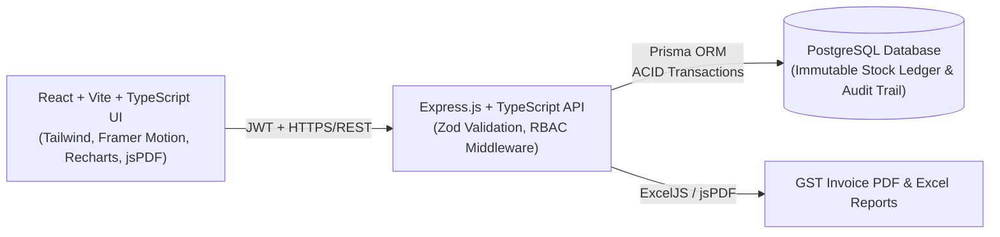
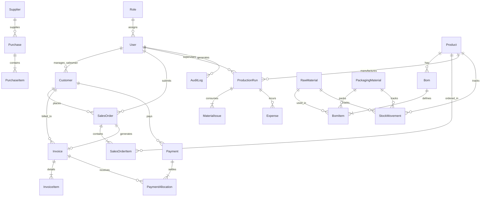

# SavorSouth Foods ERP — Architecture & Design Note

**Company:** SavorSouth Foods (Tamil Nadu, India)  
**Tagline:** *Tradition in Every Bite.*  
**Product:** SavorSouth ERP — Order-to-Audit Manufacturing & GST Management System  
**Challenge:** NIT Tiruchirappalli Centre for Digital Infrastructure — Winter Internship 2026

---

## 1. Reference Website Analysis (`https://tastyworld.in/`)

A live inspection of `https://tastyworld.in/` across desktop (`1440×900`), tablet (`768×1024`), and mobile (`375×812`) viewports revealed the following brand and UX patterns:

1. **Brand & Heritage Storytelling:** Emphasizes authentic regional recipes, low-oil preparation, and traditional Indian food staging (brass/silver vessels, warm cream/white surfaces, subtle mandala motifs).
2. **Color & Typography:** High-contrast dark navigation framing a bright white catalog canvas with warm gold/saffron decorative accents and bold pricing hierarchy (`Montserrat` sans-serif for product cards & pricing, paired with heritage display accents).
3. **Product Presentation:** Clean product cards displaying pack size, unit price, stock availability pill overlays, and quick-action hover states.
4. **Identified UX Gaps to Improve in SavorSouth ERP:**
   - `tastyworld.in` lacks category filters, search, sorting, and pagination on its 27-item catalog and shows uneven card heights across mixed photo styles.
   - SavorSouth ERP translates the appetizing product-first catalog into an enterprise **Order-to-Audit ERP** with unified `1:1` warm-cream studio visuals, instant search/category/status filtering, sortable paginated tables, and strict zero-overlap responsive grids across Desktop (Owner/Admin/Auditor), Tablet (Production Floor), and Mobile (Field Salesman).

---

## 2. SavorSouth Design System

- **Deep Forest Green (`#183D32`):** Primary brand anchor, collapsible sidebar, active state pills, primary action headers.
- **Warm Cream (`#FFF8ED`):** Subtle canvas warmth for product studio cards, heritage callout banners, and invoice accents.
- **Golden Yellow (`#D9A441`):** Brand highlight, production active indicators, variance warning accents, star/heritage badges.
- **Terracotta (`#B85C38`):** Secondary warm CTA, wastage/alert emphasis, South Indian culinary warmth.
- **Charcoal (`#252B29`):** Primary body typography and high-contrast data tables.
- **Pure White (`#FFFFFF`):** Crisp elevated cards, modals, and data containers.
- **Typography:** `Manrope` for headings and KPI figures (`tabular-nums`), `Inter` for dense tables, forms, and mobile salesman controls.
- **Motion:** Subtle Framer Motion transitions (`150ms–260ms`, `easeOut`), animated KPI count-ups, collapsible sidebar spring, modal scales, and full `prefers-reduced-motion` support.

---

## 3. System Architecture

- **Frontend:** React 18, TypeScript, Vite, Tailwind CSS, Framer Motion, Recharts, Lucide Icons, jsPDF + jspdf-autotable (client-side instant GST invoice PDF preview/download + server-side export support).
- **Backend:** Node.js, Express.js, TypeScript, Zod request validation, JWT (`jsonwebtoken`) authentication, `bcryptjs` password hashing, strict backend RBAC middleware per endpoint.
- **Database:** PostgreSQL with Prisma ORM (`prisma/schema.prisma`, SQL migrations, transactional `$transaction` blocks for all stock-mutating workflows).

---

## 4. Database ER Diagram

---

## 5. Core Financial & Manufacturing Methodologies

### 5.1 Integer-Paisa & Base-Unit Arithmetic
- **Money:** Every monetary column (`sellingPricePaisa`, `ratePaisa`, `taxableAmountPaisa`, `cgstPaisa`, `sgstPaisa`, `igstPaisa`, `totalValuePaisa`, `amountPaisa`) is stored as **integer paisa** (`1 INR = 100 paisa`). Zero floating-point arithmetic is used in financial totals, GST splits, or payment allocations.
- **Quantities & Unit Conversion:** Raw materials and packaging items normalize every transaction into canonical integer base units:
  - Weight: `GRAM` (`1 kg = 1000 g`)
  - Volume: `ML` (`1 litre = 1000 ml`)
  - Count: `PIECE` (`1 carton / 1 pouch = 1 piece`)
  - Finished Goods: `PACKET` (with `packetsPerCarton` conversion support)

### 5.2 Immutable Stock Ledger
- Balances are **never arbitrarily overwritten**. Every stock change (Opening, Purchase Receipt, Material Issue, Production Receipt, Sales Dispatch, Manual Adjustment) appends an immutable row to `StockMovement` with `direction (IN/OUT)`, `quantityBase`, `unitCostPaisa`, `totalValuePaisa`, `balanceAfterBase`, and `sourceDocType/sourceDocId/sourceDocNumber` inside a PostgreSQL `$transaction`.
- Negative stock is prevented at the database transaction guard level.

### 5.3 Weighted Average Cost Valuation
Each raw material and packaging material maintains `(currentStockBase, totalValuePaisa)`:
1. **On Purchase Receipt:**  
   `newStock = oldStock + purchaseQtyBase`  
   `newTotalValue = oldTotalValue + purchaseLineCostPaisa`
2. **On Production Issue:**  
   `issueCostPaisa = round(oldTotalValue * issueQtyBase / oldStock)`  
   `newStock = oldStock - issueQtyBase`  
   `newTotalValue = oldTotalValue - issueCostPaisa`

### 5.4 Production Yield, Consumption Variance & Overhead Allocation
- **Yield Variance (%):** `((actualGoodPackets - expectedOutputPackets) / expectedOutputPackets) * 100`
- **Consumption Variance (%):** `((issuedQtyBase - plannedQtyBase) / plannedQtyBase) * 100`
- **Alert Trigger:** Any variance whose absolute magnitude exceeds the configured BOM/System tolerance (default `5%`) raises an automatic variance alert on the Production Run and Owner Dashboard.
- **Overhead Allocation Rule (Direct Batch Assignment):** Direct batch overheads (`Labour` + `Gas & Electricity`) recorded against a `ProductionRun` are 100% absorbed by the good output of that batch:  
  `Total Production Cost = Raw Material Cost + Packaging Cost + Labour Cost + Gas/Electricity Cost`  
  `Cost per Good Packet = Total Production Cost / Actual Good Output Packets`

### 5.5 GST Calculation & Financial-Year Invoice Numbering
- **Factory State:** Tamil Nadu (`State Code: 33`).
- **Intra-State (`customer.stateCode === "33"`):** Total GST is split equally (`CGST = 50%`, `SGST = 50%`, `IGST = 0`).
- **Inter-State (`customer.stateCode !== "33"`):** Full GST is charged as `IGST` (`CGST = 0`, `SGST = 0`).
- **Invoice Numbering:** Financial-year scoped (`SSF/2026-27/0001`). Posted invoices are **never deleted**; cancellations update status to `CANCELLED` and auto-issue a linked Credit Note (`CN/2026-27/0001`).
